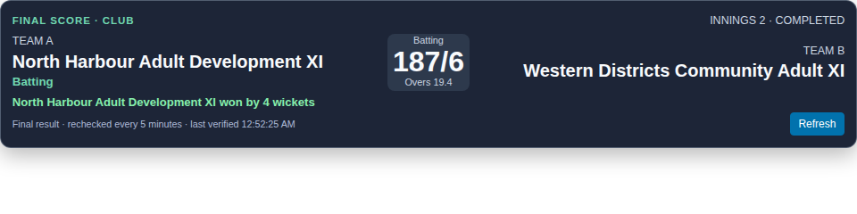
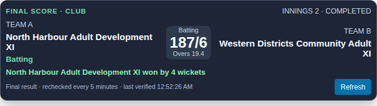
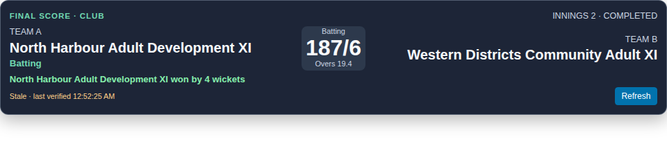
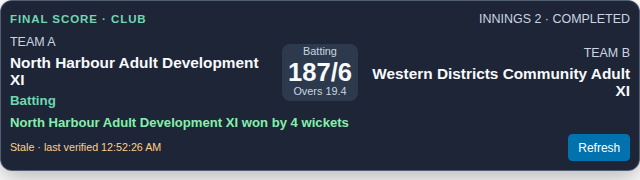
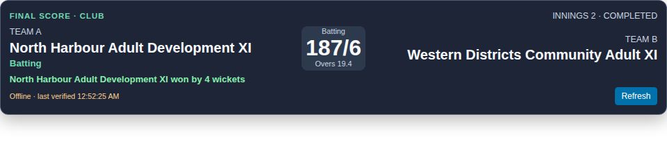
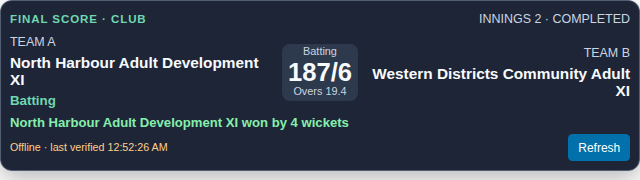
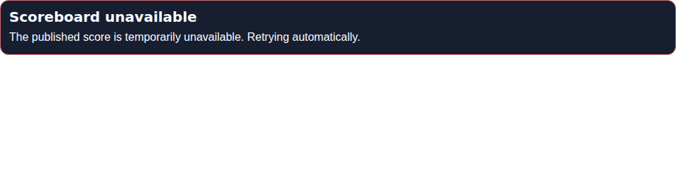
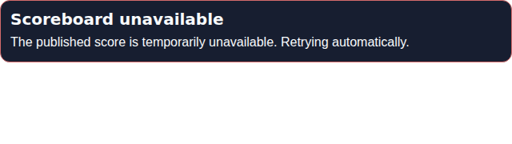
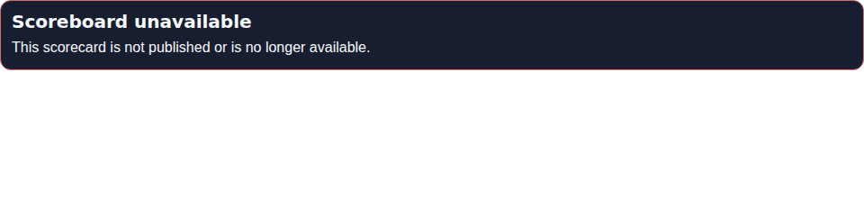
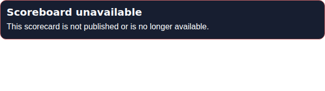

# Safe public-scorecard OBS overlay rehearsal

This guide covers only the read-only School/Club public-scorecard overlay. It does not authorize publication, broadcasting, or production use.

## Use the public opaque link

Open an already-published scorecard at:

`/community/{public_identifier}/competitions/{competition_public_key}/scorecards/{scorecard_public_identifier}`

Use **Copy OBS overlay link** on that public scorecard. The resulting URL uses the same three public opaque identifiers with `/overlay` appended. It contains no login credentials, tokens, or internal game ID. The overlay requests only the canonical public scorecard API:

`GET /api/public/organizations/{public_identifier}/competitions/{competition_public_key}/scorecards/{scorecard_public_identifier}`

Do not replace or edit the identifiers with a game ID, and do not use `/view/:gameId`, `/embed/:gameId`, or an authenticated score page. The API rechecks organization, competition, and match publication, active organization, and the current School Free/Club Free capability on every request. A not-found response clears the displayed score and stops automatic polling.

## OBS Browser Source dimensions

1. In OBS, add a **Browser Source** and paste the copied overlay URL.
2. Use **960 × 240 px** as the recommended source size. A compact **640 × 180 px** source is also supported; check team-name wrapping at the chosen size.
3. Keep the browser source background transparent. The score card itself has a dark, high-contrast background.
4. The page checks every 12 seconds while visible. Transient failures back off exponentially, capped at 60 seconds; the last verified score remains marked stale. Final scorecards continue to revalidate every 5 minutes so later revocation or result correction is detected. A browser offline event pauses polling until connectivity returns.
5. OBS/browser visibility signals do not establish whether a source is actually on-air. Validate the source manually during a rehearsal; this engineering work is not an actual OBS rehearsal.

## Synthetic rendered checks

The following Chromium screenshots use synthetic adult team/player names. Both source sizes were checked at the exact viewport dimensions; final-state card heights measured 166 px at 960 × 240 and 171 px at 640 × 180, and final, stale, offline, transient-error, and revoked states had no horizontal or vertical document overflow. The error card's computed text is `rgb(248, 250, 252)` over `rgb(23, 30, 48)`, a contrast ratio of 15.87:1 (above WCAG AA for body text and large headings). The error card measured 78 px high at both source sizes. The long names wrap within the team columns.

| State | 960 × 240 | 640 × 180 |
|---|---|---|
| Final result |  |  |
| Stale after transient failure |  |  |
| Offline with last verified score |  |  |
| Initial transient failure |  |  |
| Publication revoked (404) |  |  |

## Synthetic, adult-only rehearsal

Before connecting any real match, rehearse with a synthetic scorecard and two adult test teams. Use made-up team names and runs/wickets to confirm the score, legal overs, innings/status, final-result text, refresh behavior, and revocation handling. Do not use pupil names or real junior match data in screenshots, fixtures, recordings, or rehearsal material.

The current canonical public scorecard response still includes published player names in batting/bowling rows and player names under team details. The overlay does not render those rows or names, but that is **UI hiding, not network-level redaction**. The feed is therefore not anonymous or pupil-safe, and this change makes no consent, safeguarding, legal-clearance, or broadcast-readiness claim. Real junior broadcasting remains outside this pilot slice.

## Limits and rollback

This overlay is read-only; it does not provide a video player, stream integration, scoring controls, or an OBS/on-air signal. The browser viewport checks and focused UI tests do not substitute for a real OBS rehearsal.

To roll back this slice, remove the overlay route and layout mode, the overlay branch/polling and copied-link button from the existing public scorecard view, and this guide. The canonical public API and its publication gates remain unchanged.
